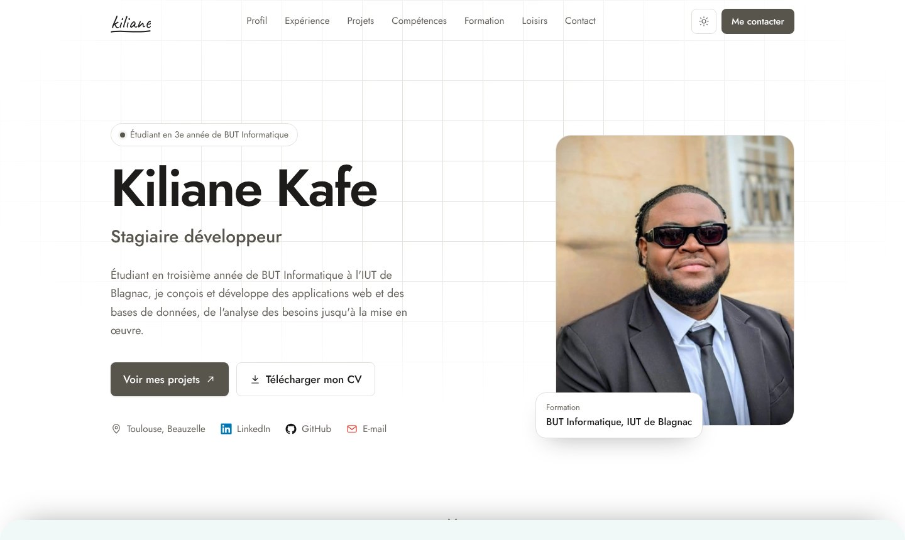

# Portfolio – Kiliane Kafe

Portfolio personnel d'un étudiant en 3e année de BUT Informatique à l'IUT de Blagnac : parcours, projets, compétences et centres d'intérêt, sur une seule page.

**Voir le site : [kkafe.github.io](https://kkafe.github.io)**



## Fonctionnalités

- **Ambiances de couleurs par section** : chaque partie du site a sa palette (turquoise pour le profil, marine et or pour l'expérience, noir et vert pour la musique…), avec des panneaux qui glissent les uns sur les autres au défilement.
- **Animations fluides** : les animations liées au défilement sont calculées par le navigateur (CSS `animation-timeline`), sans JavaScript pendant le scroll.
- **Six compétences** en accordéon, ouvertes au survol : pour chacune, ma progression et les projets qui la prouvent.
- **Liens entre projets et compétences** dans les deux sens : chaque projet renvoie aux compétences qu'il mobilise, chaque compétence renvoie à ses preuves.
- **Formulaire de contact** qui transmet les messages par e-mail (service FormSubmit), sans serveur.
- **Cartes de présentation** (fenêtres `<dialog>` accessibles) pour chaque langage et chaque pays visité, avec photo du monument.
- **Globe interactif** des voyages, dessiné en canvas (environ 7 000 points), chargé seulement à l'approche de la section.
- **Mode clair et sombre**, mémorisé dans le navigateur.
- **Responsive** du petit téléphone (320 px) au grand écran, et accessible au clavier (onglets, menus, fenêtres).
- Respect du réglage « réduire les animations » du système.


## Technologies

| Rôle | Outil |
| --- | --- |
| Interface | React 19, TypeScript |
| Styles | Tailwind CSS 4 |
| Animations | Motion (chargé à la demande avec `LazyMotion`), animations CSS liées au défilement |
| Build | Vite |
| Logos des langages | Devicon (`devicons-react`) |
| Mise en ligne | GitHub Pages, via GitHub Actions |

## Performances

- Code découpé : le globe et les fonctions d'animation sont chargés à part, après l'ouverture de la page.
- Police de la signature réduite aux seules lettres utilisées (5 Ko au lieu de 75 Ko).
- Images au format WebP, chargées seulement quand elles arrivent à l'écran.
- Note Lighthouse mobile : 89 en performance, 100 en bonnes pratiques.

## Structure du code

```
portfolio-react/
├── .github/workflows/deploy.yml   Mise en ligne automatique sur GitHub Pages
├── docs/                          Captures d'écran du README
├── public/                        Fichiers copiés tels quels sur le site
│   ├── cv/CV-Kiliane-Kafe.pdf     CV téléchargeable
│   ├── icons/                     Icônes de l'onglet, du téléphone et de l'application
│   ├── favicon.svg                Logo affiché dans l'onglet du navigateur
│   ├── og-image.jpg               Image affichée quand le lien est partagé
│   └── site.webmanifest           Nom et icônes quand le site est ajouté à l'écran d'accueil
├── src/
│   ├── main.tsx                   Point d'entrée
│   ├── App.tsx                    Assemble les sections de la page
│   ├── sections/                  Une section de la page par fichier
│   │                              (Hero, Profile, Experience, Projects, Skills,
│   │                               Education, Hobbies, Contact, Footer)
│   ├── components/                Éléments réutilisables
│   │   ├── Navbar.tsx             Barre de navigation
│   │   ├── SkillsAccordion.tsx    Les six compétences, avec progression et preuves
│   │   ├── CompetenceLinks.tsx    Liens d'un projet vers ses compétences
│   │   ├── ContactForm.tsx        Formulaire de contact
│   │   ├── InfoCardDialog.tsx     Carte de présentation d'un langage ou d'un pays
│   │   ├── LegalNoticeDialog.tsx  Mentions légales
│   │   ├── TravelGlobe.tsx        Globe des voyages
│   │   ├── TechLogo.tsx           Logos des langages et outils
│   │   ├── SocialLogos.tsx        Logos LinkedIn, GitHub, e-mail
│   │   ├── UiIcons.tsx            Petites icônes (menu, flèche, soleil…)
│   │   └── …                      SectionHeader, Signature, ThemeToggle, Timeline, ScrollProgress
│   ├── data/                      Tous les textes du site
│   │   ├── content.ts             Profil, expériences, projets, compétences et leurs preuves, loisirs
│   │   ├── infoCards.ts           Contenu des cartes (langages et pays)
│   │   └── globe-land-dots.json   Points des continents pour le globe
│   ├── hooks/                     Section active, ambiance de couleurs, couleurs du thème
│   ├── animations/                Réglages des animations (Motion)
│   ├── styles/global.css          Couleurs, ambiances et animations de défilement
│   └── assets/
│       ├── fonts/                 Police de la signature
│       └── images/                Photo de profil, affiches (games/) et pochettes (music/)
├── index.html                     Page HTML, titre et métadonnées de partage
├── package.json                   Dépendances et scripts
└── vite.config.ts                 Configuration du build
```

Pour modifier un texte, tout se trouve dans `src/data/content.ts` et `src/data/infoCards.ts`.

## Lancer le projet

Il faut Node.js 20 ou plus.

```bash
npm install      # installer les dépendances
npm run dev      # lancer en local (http://localhost:5173)
npm run build    # vérifier les types et construire le site dans dist/
```

Chaque envoi sur la branche `main` met automatiquement le site en ligne (workflow `.github/workflows/deploy.yml`).

## Crédits

- Photos des monuments : Wikimedia Commons, sous licences Creative Commons (auteurs cités sur chaque carte du site).
- Logos : projet [Devicon](https://devicon.dev) (licence MIT) ; les marques appartiennent à leurs propriétaires.
- Polices : Jost et Caveat (SIL Open Font License).

© 2026 Kiliane Kafe. Textes, photo et code : tous droits réservés.
