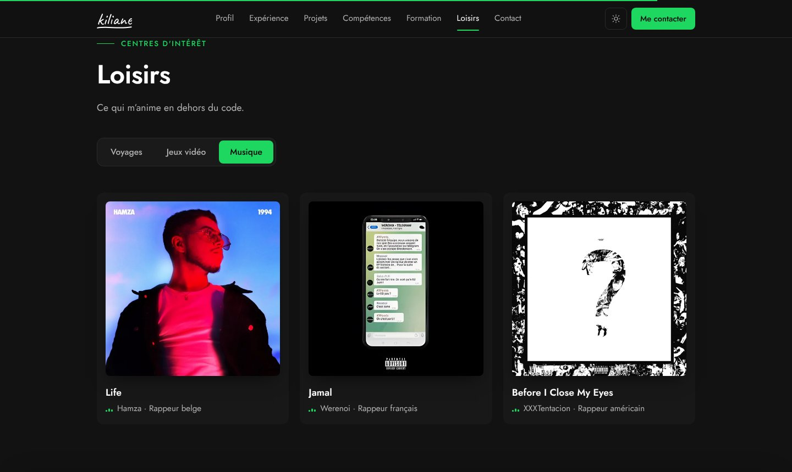

# Portfolio – Kiliane Kafe

Portfolio personnel d'un étudiant en 3e année de BUT Informatique à l'IUT de Blagnac : parcours, projets, compétences et centres d'intérêt, sur une seule page.

**Voir le site : [kkafe.github.io](https://kkafe.github.io)**


## Fonctionnalités

- **Ambiances de couleurs par section** : chaque partie du site a sa palette (turquoise pour le profil, marine et or pour l'expérience, noir et vert pour la musique…), avec des panneaux qui glissent les uns sur les autres au défilement.
- **Animations fluides** : les animations liées au défilement sont calculées par le navigateur (CSS `animation-timeline`), sans JavaScript pendant le scroll.
- **Compétences du BUT** en accordéon, qui s'ouvre au survol.
- **Cartes de présentation** (fenêtres `<dialog>` accessibles) pour chaque langage et chaque pays visité, avec photo du monument.
- **Globe interactif** des voyages, dessiné en canvas (environ 7 000 points), chargé seulement à l'approche de la section.
- **Mode clair et sombre**, mémorisé dans le navigateur.
- **Responsive** du petit téléphone (320 px) au grand écran, et accessible au clavier (onglets, menus, fenêtres).
- Respect du réglage « réduire les animations » du système.



## Technologies

| Rôle | Outil |
| --- | --- |
| Interface | React 19, TypeScript |
| Styles | Tailwind CSS 4 |
| Animations | Motion (chargé à la demande avec `LazyMotion`), animations CSS liées au défilement |
| Build | Vite |
| Logos des langages | Devicon (`devicons-react`) |
| Mise en ligne | GitHub Pages, via GitHub Actions |

## Performances

- Code découpé : le globe et les fonctions d'animation sont chargés à part, après l'ouverture de la page.
- Police de la signature réduite aux seules lettres utilisées (5 Ko au lieu de 75 Ko).
- Images au format WebP, chargées seulement quand elles arrivent à l'écran.
- Note Lighthouse mobile : 89 en performance, 100 en bonnes pratiques.

## Structure du code

```
src/
├── App.tsx              Assemblage des sections
├── data/                Tous les textes du site (content.ts, cards.ts)
├── sections/            Une section par fichier (Hero, Profile, Experience, Projects, Skills…)
├── components/          Éléments réutilisables (Navbar, Globe, InfoCard, Logo…)
├── hooks/               Section active, ambiance de couleurs, couleurs du thème
└── index.css            Couleurs, ambiances et animations de défilement
public/                  CV, logo, icônes et image de partage
```

Pour modifier un texte, tout se trouve dans `src/data/content.ts` et `src/data/cards.ts`.

## Lancer le projet

Il faut Node.js 20 ou plus.

```bash
npm install      # installer les dépendances
npm run dev      # lancer en local (http://localhost:5173)
npm run build    # vérifier les types et construire le site dans dist/
```

Chaque envoi sur la branche `main` met automatiquement le site en ligne (workflow `.github/workflows/deploy.yml`).

## Crédits

- Photos des monuments : Wikimedia Commons, sous licences Creative Commons (auteurs cités sur chaque carte du site).
- Logos : projet [Devicon](https://devicon.dev) (licence MIT) ; les marques appartiennent à leurs propriétaires.
- Polices : Jost et Caveat (SIL Open Font License).

© 2026 Kiliane Kafe. Textes, photo et code : tous droits réservés.
